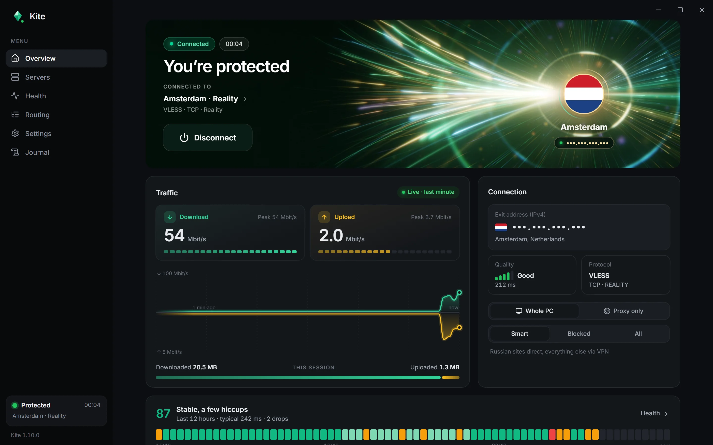
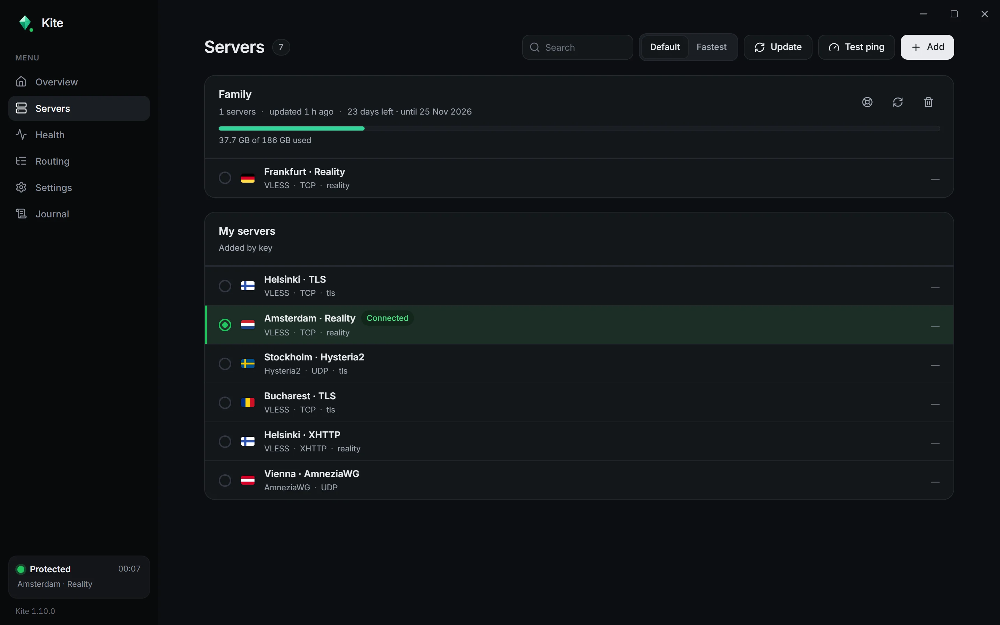
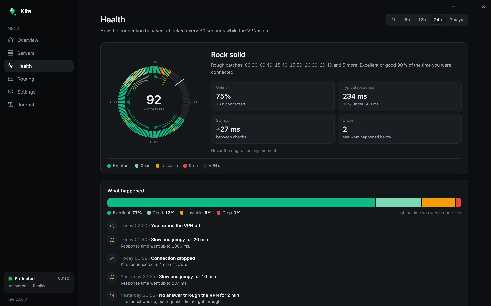
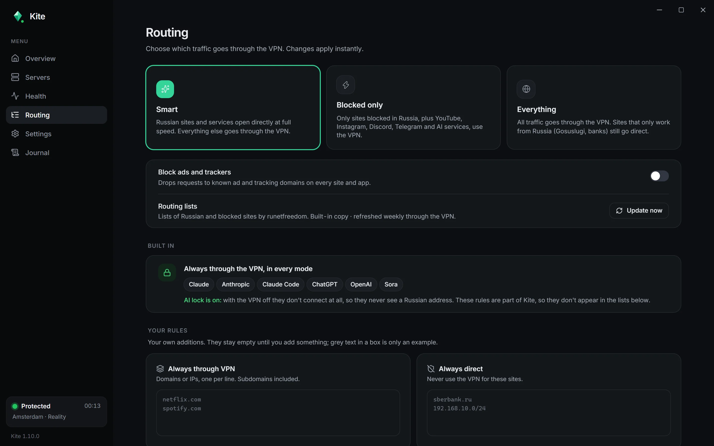

# Kite

**A calm, one-button VPN client for Windows.**

Paste a key, press Connect. Kite keeps the tunnel up, picks healthy servers on its own
and tells you in plain words what is going on.

[**Download for Windows**](https://github.com/sannyspb/kite-releases/releases/latest/download/Kite-setup.exe)
&nbsp;·&nbsp; [All releases](https://github.com/sannyspb/kite-releases/releases)
&nbsp;·&nbsp; [Website](https://kitewithme.com)

Windows 10 / 11 (64-bit) · signed automatic updates

## What is Kite?

Kite is a desktop **VPN client**: it connects your PC to a VPN server you already have access to.
It is not a VPN service and does not come with servers of its own. You need a key from whoever runs
your server: a share link (`vless://`, `hy2://`, ...), a subscription URL, or a WireGuard / AmneziaWG
config. Kite reads it, finds the servers inside and keeps the list up to date by itself.

It is made for people who just want "the internet, working": no accounts, no ads, no tracking,
no settings you have to understand.

## Features

- **One button.** Install, paste your key, press Connect.
- **Whole PC or just the proxy.** Send every app through the tunnel (TUN mode), or only set the Windows system proxy.
- **Smart routing.** Local sites open directly at full speed, everything else goes through the VPN.
  Or send only blocked sites through it, or everything. Add your own "always VPN" and "always direct" rules.
- **Stays up by itself.** Checks the tunnel every 30 seconds, rides out shaky Wi-Fi, reconnects
  and moves to a healthier server when the current one gets slow.
- **Real server tests.** Each server is measured with a real request through it, not a ping,
  without touching your live connection.
- **Health page.** A 24-hour clock and a week map of how the connection behaved, plus a plain-words event log.
- **Kill switch** (optional). If the tunnel drops, Windows keeps the internet shut until Kite is back,
  so your real address never leaks.
- **AI lock.** Claude and ChatGPT only ever connect through the tunnel, in the browser and in their apps.
- **Ad and tracker blocking** (optional).
- **Updates itself.** New versions are signed and arrive with one click.
- Light and dark themes.

## Supported connections

| Type | Notes |
|---|---|
| VLESS | TCP, WebSocket, gRPC, HTTPUpgrade, XHTTP; TLS and Reality |
| VMess, Trojan, Shadowsocks | |
| Hysteria2, TUIC, AnyTLS | |
| WireGuard | share links and `.conf` files |
| AmneziaWG 1.0 – 2.0 | `.conf` files, pasted config text or AmneziaVPN `vpn://` keys |
| Subscriptions | standard base64 / plain link lists, with traffic and expiry info when the server provides it |

## Screenshots

| Servers | Health |
|---|---|
|  |  |

 Routing

## Install

1. Download [`Kite-setup.exe`](https://github.com/sannyspb/kite-releases/releases/latest/download/Kite-setup.exe)
   (always the latest version) and run it.
2. Windows asks for administrator rights once, during installation. Kite needs them to create the
   network adapter for the "whole PC" mode; after that it starts without prompts.
3. Open **Servers → Add**, paste your key or subscription link and press **Connect**.

If Windows SmartScreen shows "Windows protected your PC", click **More info → Run anyway**.

## Updates

Kite checks for a new version shortly after launch and then every few hours, and shows
**Update now** in the sidebar. Updates are signed: Kite only installs a build whose signature
matches the key built into the app. If you were connected, it reconnects by itself after updating.

This repository is the public update feed. Every [release](https://github.com/sannyspb/kite-releases/releases)
contains the installer, its signature and the `latest.json` manifest that Kite reads.

## Privacy

Kite has no accounts, no analytics and no telemetry. Your servers and settings are stored only
on your computer. The only things Kite fetches on its own are your subscriptions, routing lists
and its own updates.

## Under the hood

Kite is built with [Tauri](https://tauri.app) (Rust + React) and drives well-known open-source
network cores: [sing-box](https://github.com/SagerNet/sing-box), [Xray](https://github.com/XTLS/Xray-core)
and [mihomo](https://github.com/MetaCubeX/mihomo). Routing lists come from
[runetfreedom](https://github.com/runetfreedom).

## Questions

Found a bug or something does not work? [Open an issue](https://github.com/sannyspb/kite-releases/issues).
Please never post your keys, links or server addresses in an issue.
